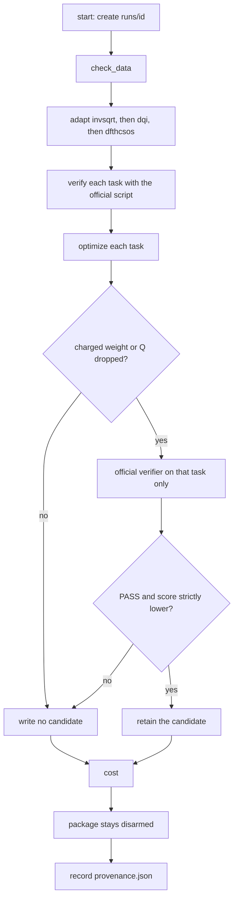

# Team tutorial: VQCC on NoETL

This is the wiki copy of `docs/tutorial/README.md`. Wording matches that page. Links on this copy use wiki page names.

Briefing for the team working on the Kaggle competition
[Google Quantum AI — Verifiable Quantum Circuit Compilation](https://www.kaggle.com/competitions/google-verifiable-quantum-circuit-compilation).

This tutorial is the walkthrough. The authority for requirements is
`specs/001-noetl-pipeline/spec.md` on main `da8490eed953875d6e7bb3a2f306554f41620905`
(the merge of [PR #20](https://github.com/noetl/quantum/pull/20)). That spec
text was introduced with the skeleton and has not been edited since. The
constitution is `.specify/memory/constitution.md`. Open scoring markers in
the spec stay open. This tutorial does not close them.

The repository copy of this index is `docs/tutorial/README.md`.

## Read in this order

| Step | Page | What you leave with |
| --- | --- | --- |
| 0 | [Overview and goals](Tutorial-00-Overview) | The competition, the team hub, and why the work is a NoETL playbook |
| 1 | [Environment](Tutorial-01-Environment) | NoETL 5.3.2, kickmix 1.0.0, the local runtime, and DSL validation |
| 2 | [Datasets](Tutorial-02-Datasets) | Where each task's inputs live on Kaggle, and why they are not in git |
| 3 | [Playbooks](Tutorial-03-Playbooks) | What `vqcc_pipeline.yaml` and `vqcc_optimize.yaml` do, step by step |
| 4 | [Scoring](Tutorial-04-Scoring) | Per-task costs, the verifier JSON, and the fail-closed rule |
| 5 | [Running on Kaggle](Tutorial-05-Kaggle) | The private notebook, Save & Run All, the ancestor check, and the ban on submitting |
| 6 | [Optimization history](Tutorial-06-History) | Each PR, issue, and Kaggle version, with the result |
| 7 | [Current work](Tutorial-07-Current-Work) | What main contains now, and what happens next |
| 8 | [Deliverables and acceptance](Tutorial-08-Deliverables) | Checklists per workstream, tied to issues and FR ids |
| 9 | [Open questions](Tutorial-09-Open-Questions) | FR-006, FR-007, and FR-008, still pending clarification |
|  | [Glossary](Tutorial-Glossary) | Terms used in the tutorial |

## Pipeline at a glance

`playbooks/vqcc_optimize.yaml` is the path that rewrites a verified baseline.
`playbooks/vqcc_pipeline.yaml` is the same walk without the optimize steps.
Both end with a null `leaderboard_score`. A candidate is kept only when the
official verifier returns `PASS` and a strictly lower JSON `score`.

The optimize nodes exist only in `vqcc_optimize.yaml`. The baseline playbook
goes from verify to cost. Detail is in [Playbooks](Tutorial-03-Playbooks).

## Where the numbers come from

Baseline scores and the version 7, version 8, and version 9 outcomes below are taken
from the private notebook logs and from the issue comments those logs were
posted to. They are not measurements made by cloning this repository on a
machine that has no competition data. Anything this briefing could not
check is marked **unverified** or **pending**.
